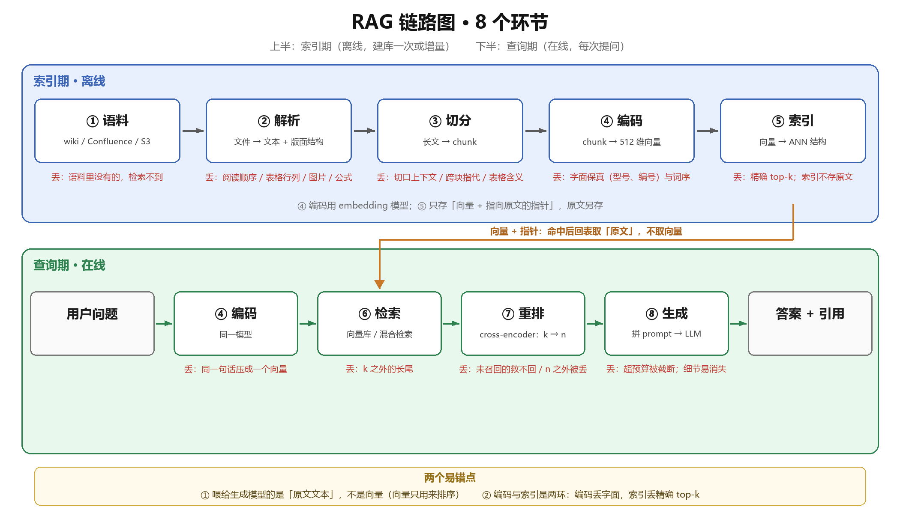
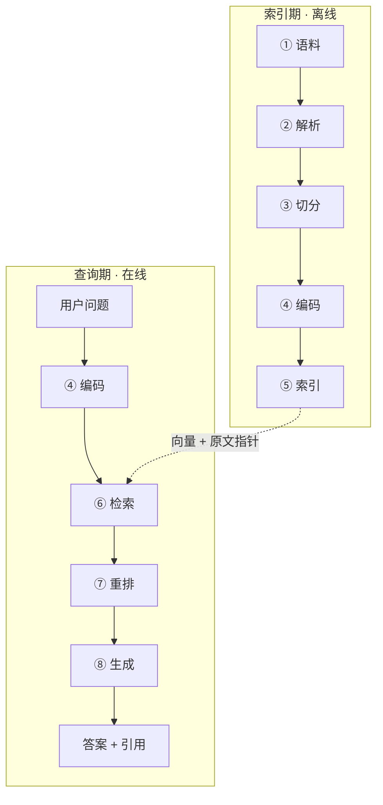

# D01 · RAG 链路图（[AI] 绘制，2026-11-23）

> **来源标记：`[AI]`** —— 本图由 AI 按要求绘制，供本人学习对照；**不计入个人验收**
> （个人验收已由 14:47 的口述默写 8/8 完成，见 [07-八环默写-本人版.md](07-八环默写-本人版.md)）。
> 图里的「丢什么」取自 07 文件中本人原话，AI 只补了精度。

---

## 一、整体图（PNG，推荐看这张）



> 由 `code/render_rag_chain.py` 生成（Pillow，2100×1240）。改文字或配色就改脚本重跑，别手改图片。

## 二、一页速览（纯文本，无边框，任何字体都不会错位）

> 不用框线——框线的右边一定会在某些字体/编辑器里错位（中文、①、→ 到底算 1 格还是 2 格，各环境判断不同）。
> 这里改成一行一步，**没有右边框，就不用对齐**。要「图」看第一节的 PNG。

**索引期（离线，只做一次）**

```
① 语料 → ② 解析 → ③ 切分 → ④ 编码 → ⑤ 索引
```

- 每环丢什么：① 语料外的内容 → ② 版面与阅读顺序 → ③ 跨块的半句话 → ④ 字面保真 → ⑤ 精确召回

**查询期（在线，每次提问）**

```
用户问题 → ④ 编码 → ⑥ 检索 → ⑦ 重排 → ⑧ 生成 → 答案 + 引用
```

- 每环丢什么：④ 问题的细节 → ⑥ 近似漏召 → ⑦ 粗排的假阳性 → ⑧ prompt 截断

**⑤ → ⑥ 唯一的跨栏连接**

```
⑤ 的产物 = 向量库（向量 + 原文指针）  →  ⑥ 查它，命中后回表取原文，不取向量
```

## 三、逐环：输入 / 输出 / 丢什么 / 工程上怎么补

| # | 环节 | 输入 → 输出 | 丢什么（本人已答对） | 工程手段 |
|---|---|---|---|---|
| ① | 语料 | 数据源 → 可解析文件 | 语料里没有的内容，检索不到（**天花板**） | 多源接入、增量同步、清洗去重 |
| ② | 解析 | 文件 → 纯文本 + 版面结构 | 阅读顺序、表格**行列关系**、图片、公式 | OCR、版面分析、TSR 表格结构识别 |
| ③ | 切分 | 长文本 → chunk | 切口处上下文、跨块**指代**、被切断的表格含义 | 结构化切分、父子块、重叠、表头重复 |
| ④ | 编码 | 文本 → 定长向量 | **字面保真**（型号/编号/人名）、词序 | 混入稀疏检索（BM25）、late interaction |
| ⑤ | 索引 | 向量集合 → ANN 结构 | **精确 top-k 保证**；索引里不存原文 | 调 ef/nprobe、过采样、多路召回、量化+重排 |
| ⑥ | 检索 | 问题 → top-k 原文 | k 之外的长尾（k 太小漏、太大噪声） | 混合检索、query 改写、多路融合 |
| ⑦ | 重排 | 问题**原文** + k 条候选**原文** → 重排后 n 条 | 救不回未召回的；n 之外的也被丢 | cross-encoder、规则、LLM 打分 |
| ⑧ | 生成 | prompt → 答案 | 超出预算被截断；数字/条件/限定语易消失 | 引用标注、分块总结、结构化输出 |

## 四、三个最容易犯的错

1. **说「向量喂给模型」** —— 错。喂给生成的是**原文文本**；向量只用来「找」，找到即弃。
2. **把编码和索引并成一环** —— 错。编码丢「字面」，索引丢「精确 top-k」，两类损失不同、补法也不同。
3. **用相似度绝对值当阈值** —— 错。0.8 不代表相关；只有同一个 query 内的**排序**有意义（今天实测非对角区间 0.189–0.826）。

## 五、看图时的三个观察点

1. **只有 ④ 出现了两次**（离线建库 + 在线提问），且必须是**同一个模型**——换模型等于换了一个向量空间，旧索引直接失效。
2. **⑤→⑥ 那条虚线是整套系统的支点**：向量负责「像」，指针负责「真」。只存向量不存原文，检索出来的东西没法读。
3. **⑦ 是可选的**，论文里没有；但 ⑥ 的近似性必须靠 ⑦ 兜底，这是工程与论文的分界。

## 附录：Mermaid 源码（你的编辑器不渲染 Mermaid，可忽略；要图请用第一节 PNG，要改图可粘到 mermaid.live）



> **渲染不了怎么办**：Mermaid 需要在支持它的环境里才出图——
> - ✅ GitHub / GitLab 网页、Typora、Obsidian（需开 Mermaid）、在线 [mermaid.live](https://mermaid.live)（粘代码即出图）
> - ⚠️ VS Code 要装 **Markdown Preview Mermaid Support** 扩展
> - ❌ 若你的编辑器显示成一段代码，就是没装渲染器，看第一节的 PNG 即可
>
> 这张图的**权威版本是 PNG**（第一节）。Mermaid 只是源码形态，方便以后改。
