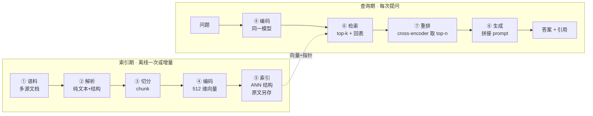

# D01 主笔记：RAG 链路图（8 环节）

## 一、一句话

RAG 把知识从模型参数里搬出来，放进一个可替换、可检索、可引用的外部索引。模型只负责两件事：把问题编码成查询，把检索回来的原文用自然语言组织成答案。

它补的正是参数化记忆的三个硬伤。改不了，换知识要重训；说不清，给不出出处；编得出来，也就是幻觉。

## 二、两段式结构

```
索引期（离线，一次或增量）——慢、贵、可批处理
  语料 ──► 解析 ──► 切分 ──► 编码 ──► 索引
  (原始库) (纯文本) (chunk)  (向量)   (ANN 结构)

查询期（在线，每次提问）——快、便宜、要低延迟
  问题 ──► 编码 ──► 检索 ──► 重排 ──► 生成 ──► 答案
          (查询向量) top-k    n 条     拼接上下文
```

两处容易画错。

一处是编码在图上出现两次，但不是同一个东西。文档侧编码器负责建索引，离线跑；查询侧编码器负责把问题变向量，在线跑。双塔架构下两者模型相同、参数共享，但输入分布不同，这就是 D02 要讲的非对称检索。

另一处是重排不是必选。2020 年的 RAG 论文里根本没有重排环节，它直接用 top-k 边缘化。重排是后来工程实践补上的，因为向量召回只能保大致相关，保不住精确答得上。所以链路图有 8 环，论文只覆盖 6 环，图上比你读的材料多出来的那部分，正是工程层。

## 三、8 环节 × 输入/输出/实现/信息损失

| # | 环节 | 输入 | 输出 | 论文 2020 | RAGFlow v0.27.3 | 丢什么信息 |
|---|---|---|---|---|---|---|
| 1 | 语料 | 业务数据 | 可解析文件 | 单一 Wikipedia dump（2018-12，21M 条） | 多知识库，用户上传 | 覆盖不到的长尾知识，检索的天花板在这里就定了 |
| 2 | 解析 | PDF/DOCX/HTML | 纯文本 + 版面结构 | 无（Wiki 已是纯文本） | `deepdoc/parser/pdf_parser.py:56` | 表格结构、公式、图注、阅读顺序；双栏误合并 |
| 3 | 切分 | 长文本 | 定长/结构块 | 固定 100 词、不重叠 | `rag/app/naive.py:1123` | 跨块语义、代词所指、表头与表体的绑定 |
| 4 | 编码 | chunk 文本 | 向量 | DPR 双塔，BERT_BASE | `rag/llm/embedding_model.py:225` | 精确字面（型号、编号、人名）、否定词、数量词 |
| 5 | 索引 | 向量集合 | ANN 结构 | FAISS + HNSW | `task_executor.py:744` → `create_idx` | 近似召回（HNSW 不保证精确 top-k）；量化丢精度 |
| 6 | 检索 | 查询向量 | top-k 文档 | MIPS 取 top-k，k∈{5,10} | `rag/nlp/search.py:717` | 长尾：正确文档排在第 k+1 位就永不见天日 |
| 7 | 重排 | query + k 条 | 前 n 条 | 无此环节 | `rag/nlp/search.py:673` | 只看 query 与单文档的配对，看不见多文档互补；截断丢候选 |
| 8 | 生成 | query + n 条 | 答案 | BART-large，直接拼接 | `rag/prompts/generator.py:168` | 上下文预算、lost-in-the-middle、无法引用到句 |

## 四、每一环的不可逆在哪（验收要求的那句话）

解析不可逆。PDF 一旦被拍平成字符串，双栏顺序、表格行列关系就没了，后面再聪明也补不回来，所以 RAGFlow 花了 `pdf_parser.py` 上千行做版面。（表格为什么丢，见 §七.1）切分同样不可逆，chunk 边界一划，跨块指代就断了，增大重叠只是缓解，没有消除。

编码不可逆。512 维稠密向量是把文本压进一个语义空间，字面精确匹配能力被牺牲，这就是工程上还要 BM25 混检的原因（D04）。

索引不可逆，ANN 为了速度放弃精确性，HNSW 的 `ef` 一调，召回率就变。检索不可逆，top-k 是硬截断，k 之外的文档对后续环节完全不可见。（为什么精确检索必须全量比，见 §七.2）

重排也不可逆，从 k 条砍到 n 条，被砍掉的文档此后不再参与生成。生成这一环同样，模型只能看到塞进上下文的那部分，塞不进去等于不存在。

## 五、参数化 vs 非参数化

| 维度 | 参数化记忆（模型权重） | 非参数化记忆（外部索引） |
|---|---|---|
| 更新方式 | 重训 / 微调 / 继续预训练 | 换索引、加文档（论文里 82 位领导人实验：换索引即更新） |
| 更新成本 | 高（GPU 小时） | 低（离线建一次） |
| 可解释性 | 不可读 | 原文可读、可引用 |
| 幻觉 | 高（无依据也敢答） | 低（有依据时更事实） |
| 覆盖范围 | 训练截止时点 + 训练分布 | 由语料决定，可随业务替换 |
| 失效场景 | 知识过时、长尾事实 | 检索不到就全盘失效（垃圾进垃圾出） |

RAG 的取舍是：用检索可能失败，换知识可维护。所以每一环的评测都要能回答一个问题，如果这里失败，答案会怎样。这就是 D06 误差分析要干的事。

## 六、自测（遮住右列能默写才算过）

1. 8 个环节，不看表默写，顺序对吗？
2. 哪两个环节里都有编码，它们为什么不是同一个步骤？
3. 重排为什么不在论文里？它在工程上补的是什么？
4. 如果检索召回率从 90% 掉到 60%，链路图上有哪几环会连带受影响？（至少答 3 环）
5. RAG 一定比微调便宜吗？什么情况下反而不划算？

> 第 4 题是这天的思考题，答案不在任何材料里，需要自己推。

## 七、两个追问的答案（2026-11-23 补）

### 7.1 解析为什么丢表格的行列关系

因为表格的行列不是文本的属性，是版面的属性。

| 来源 | 结构在文件里吗 | 解析后是否丢 |
|---|---|---|
| PDF（文字层） | 否，只有某坐标上画了几个字 + 若干线条 | 丢，必须靠 x/y 聚类或线条重建 |
| 扫描件 / 图片 PDF | 否，只有像素 | 更糟：先 OCR 出字框，再猜网格 |
| DOCX | 是，`<w:tbl>` 有行/列/合并单元格 | 通常不丢，除非中途被转纯文本 |
| XLSX / CSV | 是，网格就是原生结构 | 不丢（`项目A/processing/spreadsheet.py:31 sheet_markdown`） |
| HTML | 是，`<table>/<tr>/<td>` | 不丢，除非只用 innerText 抽取 |

所以严格说法是：丢表格的是 PDF 这条路径。`项目A/processing/parsers/pdf.py:161` 走 pypdf 文本层 + OCR sidecar，没有表格结构识别（TSR），PDF 表格必然展平。

丢失的三种形态：列交错，某一列换行后，抽取顺序变成 `名称 螺丝 单价 3.5`，列与表头的对应关系消失；合并单元格，`rowspan=2` 的华东区只出现一次，展平后第二行没有归属；跨页表断，表头在第 3 页、续行在第 4 页，后半截成了无表头的裸数字。

为什么害到 RAG：单元格脱离表头就没意义。`3.5` 是单价还是涨跌幅，字面上无法判断；检索也抓不到 3.5 属于单价列这个绑定，因为该绑定只存在于行列关系里。

工程上三种态度。一是重建：RAGFlow 里 `deepdoc/vision/__init__.py:42 TableStructureRecognizer`，在 `pdf_parser.py:90` 实例化、`_extract_table_figure:1307` 里调 TSR，注释 `:476` 写明「Use rotated image for TSR」；重建结果是预测值，漏行错列是常态。二是不重建，解析服务A 的 PDF 路径靠标题路径补偿。三是序列化保留，xlsx/csv 转 markdown 表格，见 `项目B/app/chunker.py:6 _table_markdown`、`:45 _table_parts`。

PDF 里的表格是画出来的，不是存出来的。解析器看到坐标和线条，行列关系靠猜；猜不出就丢，猜错就编。

### 7.2 为什么精确检索要算 100 万次余弦

因为相似度是成对函数，没有能预先排序整个库的全局捷径。

三个角度。一是 query 未知，用户会问什么是事先不知道的，无法预计算查询与文档的相似度表。二是无逆运算，`argmax_i cos(q, d_i)` 不能反解，只能把每个值算出来，或者有严格上下界才能剪枝。三是稠密向量没有稀疏结构，BM25 能靠倒排表跳过 99.9% 的文档；512 维全非零浮点没有不相关就跳过这种天然机制，全量比较成了默认。

成本核算（N=10⁶, d=512, float32）：

| 量 | 数值 |
|---|---|
| 单次比较 | 512 次乘加 |
| 全库 | 5.12 亿次乘加 |
| 全库向量字节 | 100 万 × 512 × 4 B = 2 GB |
| 每次查询要读 | 2 GB（每条都要进 CPU） |
| DDR4 带宽 ≈ 20 GB/s | 理论下限 ≈100 ms，且并发抢带宽 |

瓶颈是内存带宽，不是算力，所以工程第一反应不是优化循环，而是别读那 2 GB：HNSW 只沿图走几十个节点，IVF 只读 1% 的桶，量化（int8/PQ）把 4 字节压成 1 字节。归一化后 `cos = 点积`，省掉除法，这也是自检里 `min=max=1.000000` 的意义。

为什么不用 KD-tree 这类精确加速结构：高维有维度灾难，d>20 左右最近邻与最远邻距离差趋于 0，三角不等式给的下界失去信息量，树退化为近似全扫。精确、快、高维，三者不可兼得，RAG 放弃精确这一头。

三种结构对照：

| | 暴力 | IVF | HNSW |
|---|---|---|---|
| 思路 | 挨个问 | 先 k-means 分桶，只查 `nprobe` 个桶 | 分层图，从上层贪心下降到第 0 层 |
| 参数 | 无 | `nlist` / `nprobe` | `M` / `ef_construction` / `ef_search` |
| 代价 | O(N·d)，百毫秒级 | 桶边界文档永远找不到 | 内存大（图结构），删除难 |
| 承诺 | 一定对 | 大概率对 | 大概率对 |

精确 top-k 只能全量比一遍，成本约等于一次大矩阵乘向量；ANN 的全部意义就是不去比那 100 万次。

落点：RAGFlow 交给引擎默认，只有 `rag/utils/vastbase_conn.py:482` 写死 `m=16, ef_construction=50`；`项目B/app/vectorstore.py:47` 的 SQLite 后端是 Python 逐条 cosine，等于暴力检索、没有 ANN。这就是 D03 的实操题，加 ANN 并测延迟与召回差。

## 八、T2 参考材料：一页纸默写卡

> 这份不是我画的，本节图与卡片只是对照答案。T2 任务要自己画出 8 环，还没完成，不要把它当成自己的产出。

图（Mermaid，Obsidian/GitHub 可直接渲染）



默写卡，遮住第三列，8 环 × 一句话 × 丢什么：

| # | 环节 | 一句话 | 丢什么（默写目标） |
|---|---|---|---|
| 1 | 语料 | 决定知识边界 | 覆盖不到的长尾，天花板在这里定 |
| 2 | 解析 | 文件 → 文本 + 结构 | 版面顺序、表格行列、公式、图注（PDF 独有） |
| 3 | 切分 | 长文 → chunk | 跨块指代、表头与表体的绑定 |
| 4 | 编码 | 文本 → 定长向量 | 字面精确（型号/编号/人名）、词序 |
| 5 | 索引 | 向量 → 可搜结构 | 精确 top-k 保证；索引内无原文 |
| 6 | 检索 | 问题 → top-k 原文 | k 之外的长尾 |
| 7 | 重排 | k 条 → 前 n 条 | 候选之外的互补文档 |
| 8 | 生成 | 拼接 → 答案 | 超出上下文预算的内容 |

五个数字要能不查就说出。

- 512：bge-small-zh 的维度；10 句 demo 的非对角区间 0.189–0.826；
- 0.8256：苹果对子（同词歧义）的相似度，全场最高，也是稠密检索的短板；
- 100 万 × 512 ≈ 5.1 亿次乘加 / 2 GB 读 / ≈100 ms：暴力检索的下限；
- k 与 n：召回 k（10–200）、重排后 n（3–10），两个数不要混；
- 8 环 vs 论文 6 环：差的解析、重排是工程层自加的。

三个易错点，自查：

1. 说向量喂给模型是错的，喂的是原文文本；
2. 说索引入向量库是一步也是错的，编码丢字面、索引丢精确，是两环；
3. 说相似度 0.8 就相关同样是错的，绝对值无意义，只有同一 query 内排序有意义。
